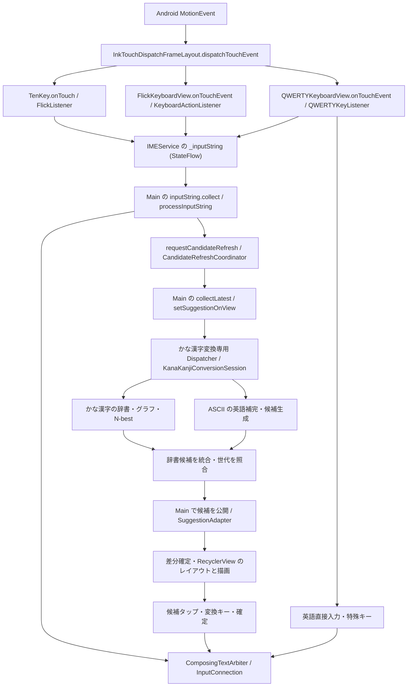

# タッチから編集・候補・確定まで

| 区間 | 実行場所と状態 | 根拠 |
|---|---|---|
| タッチ受信 | Main。候補欄の位置が変わるとき、ルート座標が古い場合は画面座標でキー View にイベントを転送する。インセット変更と誤入力を検証する際に押下位置と座標世代を確認する。 | [dispatchKeyboardTouchEvent](../../app/src/main/java/com/kazumaproject/markdownhelperkeyboard/ime_service/image_effect/InkTouchDispatchFrameLayout.kt#L67) |
| ジェスチャ | Main のポインター処理とタイマー。TenKey は旧来・独立タッチの分岐がある。Sumire はキー種別によって異なるコントローラーへ渡す。QWERTY にはキー判定、フリック判定、ポインター単位の保持がある。 | [TenKey.onTouch](../../tenkey/src/main/java/com/kazumaproject/tenkey/TenKey.kt#L1651) · [Sumire.onTouchEvent](../../custom_keyboard/src/main/java/com/kazumaproject/custom_keyboard/view/FlickKeyboardView.kt#L3643) · [QWERTY.onTouchEvent](../../qwerty_keyboard/src/main/java/com/kazumaproject/qwerty_keyboard/ui/QWERTYKeyboardView.kt#L1676) · [QWERTY.findButtonUnder](../../qwerty_keyboard/src/main/java/com/kazumaproject/qwerty_keyboard/ui/QWERTYKeyboardView.kt#L2993) |
| アクションと文字列 | IME リスナーからモード別の入力処理へ進む。編集中の読みとカーソル後方の文字列を保持する。文字列の Collector は Main でエディタ更新と候補要求を処理する。長押し・削除・カーソル同期には別の経路がある。 | [Sumire onAction](../../app/src/main/java/com/kazumaproject/markdownhelperkeyboard/ime_service/IMEService.kt#L16702) · [QWERTY release](../../app/src/main/java/com/kazumaproject/markdownhelperkeyboard/ime_service/IMEService.kt#L25662) · [inputString.collect](../../app/src/main/java/com/kazumaproject/markdownhelperkeyboard/ime_service/IMEService.kt#L20175) · [processInputString](../../app/src/main/java/com/kazumaproject/markdownhelperkeyboard/ime_service/IMEService.kt#L21938) |
| InputConnection | プレビューと確定前の標準状態を Arbiter が保持する。実際の `setComposingText` 呼び出しは IME 側の書き込みコールバック。カーソル位置はエディタから `onUpdateSelection` に戻る。 | [ComposingTextArbiter](../../app/src/main/java/com/kazumaproject/markdownhelperkeyboard/ime_service/flick_preview/ComposingTextArbiter.kt#L21) · [writeComposingText](../../app/src/main/java/com/kazumaproject/markdownhelperkeyboard/ime_service/IMEService.kt#L2099) · [onUpdateSelection](../../app/src/main/java/com/kazumaproject/markdownhelperkeyboard/ime_service/IMEService.kt#L8872) |
| 要求・表示 | Main で世代付きの候補要求を公開する。変換は専用 Dispatcher、要求やエディタの世代が現在と異なる結果は公開を見送る。アダプターの差分は別の Executor に渡ることがある。 | [requestCandidateRefresh](../../app/src/main/java/com/kazumaproject/markdownhelperkeyboard/ime_service/IMEService.kt#L22232) · [setSuggestionOnView](../../app/src/main/java/com/kazumaproject/markdownhelperkeyboard/ime_service/IMEService.kt#L28193) · [updateDisplayedCandidates](../../app/src/main/java/com/kazumaproject/markdownhelperkeyboard/ime_service/IMEService.kt#L20529) · [SuggestionAdapter](../../app/src/main/java/com/kazumaproject/markdownhelperkeyboard/ime_service/adapters/SuggestionAdapter.kt#L863) |
| 確定・削除 | 候補クリックの実装が確定先を決める。通常の確定と削除は InputConnection の呼び出し後、エディタ変化の世代を進める。長押し削除には連続更新用の抑制がある。 | [setCandidateClick](../../app/src/main/java/com/kazumaproject/markdownhelperkeyboard/ime_service/IMEService.kt#L26406) · [commitText](../../app/src/main/java/com/kazumaproject/markdownhelperkeyboard/ime_service/IMEService.kt#L32166) · [deleteSurroundingText](../../app/src/main/java/com/kazumaproject/markdownhelperkeyboard/ime_service/IMEService.kt#L32090) · [handleDeleteLongPress](../../app/src/main/java/com/kazumaproject/markdownhelperkeyboard/ime_service/IMEService.kt#L14468) |

この図は通常の編集中の経路を示す。タッチプレビューは候補リクエストより早くエディタに届きうる。直接入力や入力抑制時は候補が空のことがある。また、ライブ変換を有効にした日本語フリックでは変換候補ができるまで標準の読みの表示を遅らせる分岐がある。これらは遅延そのものと区別して集計する。 [プレビュー](../../app/src/main/java/com/kazumaproject/markdownhelperkeyboard/ime_service/flick_preview/ComposingTextArbiter.kt#L27) · [ライブ変換の表示条件](../../app/src/main/java/com/kazumaproject/markdownhelperkeyboard/ime_service/IMEService.kt#L22227)
