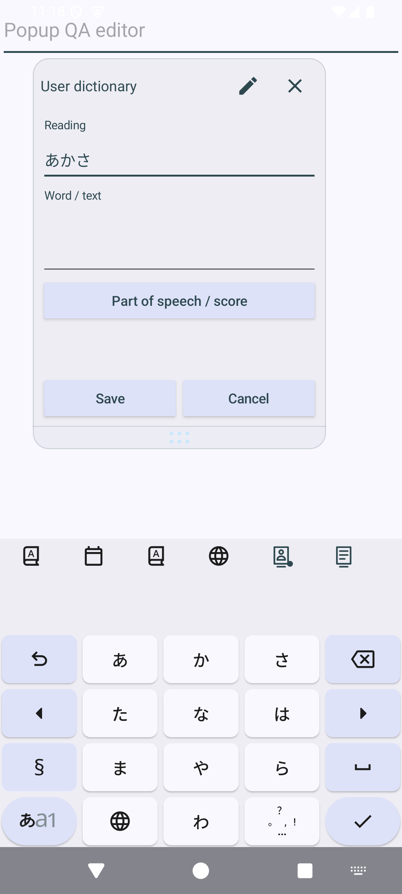
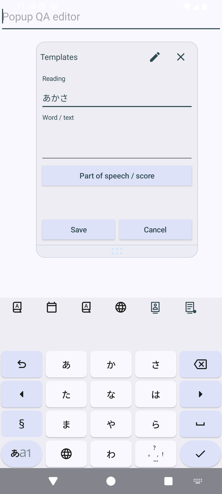
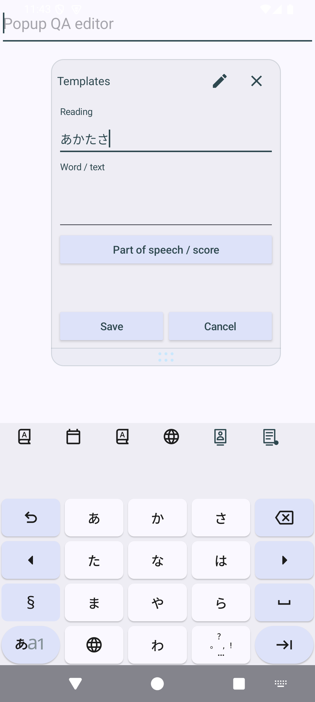

# #1187 フロート入力欄の削除・カーソル移動

## 修正前の再現

Issue: https://github.com/KazumaProject/JapaneseKeyboard/issues/1187

修正プランを作る前に、Android 15 / API 35 の起動済みエミュレータで、インストール済み Lite 1.7.135 の実キー操作によって再現した。

1. ショートカットツールバーのアイコンをタップして、ユーザー辞書フロート、または定型文フロートを開く。
2. 新規登録の入力欄に「あかさ」を入力して確定する。
3. 削除キーを押しても「あかさ」が残る。
4. 左キーを押してから「た」を入力・確定しても、途中に挿入されず「あかさた」になる。

ユーザー辞書の読み欄、定型文の読み・本文欄で確認した。保存操作は行っていない。

作業は `dev` の `fb8319890089be32f284e5e7fc2b438f783b6d28` から作成した専用 worktree / `codex/fix-1187-floating-editor-keys` で実施。

## 原因と修正

フロートは背後のアプリの入力セッションを維持するため `FLAG_NOT_FOCUSABLE` のウィンドウを使う。
`EditText.onCreateInputConnection()` が返す接続では、文字の確定や `deleteSurroundingText` はローカルの Editable を操作する一方、`sendKeyEvent` は Android のウィンドウ経由で配送する。このため、通常の削除・カーソルキーがフロートの入力欄まで届かない。

`ImeLocalInputConnection` でローカル接続をラップし、キーイベントだけを対象の `EditText.dispatchKeyEvent` に配送する。文字入力・変換・選択取得などは元の接続へ委譲する。ワーカースレッドからの配送はメインスレッドへ移し、接続が閉じた後や入力先が変わった後のイベントは破棄する。

既存の `FloatingDictionaryInputTargetTest` はキー配送をモックで置き換えていたため、この問題を検出できなかった。その置換を削除し、実接続での削除・左右移動と、接続切替・非同期配送の回帰テストを追加した。

## 検証方法

`ImePopupInstrumentedTest#floatingDictionaryEditorsHandleCommittedDeleteAndCursorKeys` は、IME の実ウィンドウと実ソフトキーを操作する。確定文字の初期値と選択範囲だけを同一プロセスのメインスレッドで設定し、削除・左右移動・移動後の挿入・長押し削除・絵文字削除・左フリック削除・未確定文字削除はキーのタッチで検証する。

`floating_kind=user` / `template` で対象を選び、新規登録と保存済み項目の編集、読み・本文の両欄を検証する。操作中に背後の入力欄が変化しないこと、フロートを閉じた後に通常入力へ戻ることも確認する。合成データと既定 IME は終了時に復元する。

初回起動直後の専用エミュレータでは System UI / Google サービスの ANR とアプリ起動タイムアウトが発生した。この試行は #1187 の再現・修正結果には数えない。

## 再実行

既存のキーボードとデータを分離する QA applicationId で実行する。

```sh
./gradlew -I investigation/floating-panel.init.gradle \
  :app:assembleLiteStandardDebug :app:assembleLiteStandardDebugAndroidTest
adb install -r -t app/build/intermediates/apk/liteStandard/debug/app-lite-standard-debug.apk
adb install -r -t app/build/intermediates/apk/androidTest/liteStandard/debug/app-lite-standard-debug-androidTest.apk
adb shell am instrument -w \
  -e class com.kazumaproject.markdownhelperkeyboard.ImePopupInstrumentedTest#floatingDictionaryEditorsHandleCommittedDeleteAndCursorKeys \
  -e floating_kind user \
  com.kazumaproject.floatingqa.lite.test/androidx.test.runner.AndroidJUnitRunner
```

`floating_kind=template` でも同様に実行する。Full は対応する Full variant と `com.kazumaproject.floatingqa.test` を使用する。別の androidTest APK が同じ provider authority を使っている端末では、QA のテスト用 manifest の authority を `${applicationId}` を使う値へ変更してビルドする。本検証では一時 init script / manifest で分離した。

関連ユニットテストは Lite / Full の `test*StandardDebugUnitTest` で、以下のクラスを実行した。

- `FloatingDictionaryInputTargetTest`
- `FloatingDictionaryControllerTest`
- `HorizontalCursorMoveHandlerTest`
- `ForwardDeleteCoordinatorTest`
- `IMEServiceForwardDeleteContractTest`

## 結果

| 構成 | 確認内容 | 結果 |
| --- | --- | --- |
| 修正前 dev / Lite / API 35 | 両アイコンから開いた登録欄で確定文字の削除 | 両方で再現（最初の削除 assertion が失敗） |
| 修正前 dev / Lite / API 36 | 同上 | 両方で再現（最初の削除 assertion が失敗） |
| 修正後 Lite / API 35 | 両フロートの新規・編集、読み・本文、通常アプリへの復帰 | 2 ケース成功 |
| 修正後 Full / API 36 | 同上 | 2 ケース成功 |
| 修正後 Lite / ユニットテスト | 入力先・フロート制御・左右移動・前方削除 | 45 件成功 |
| 修正後 Full / ユニットテスト | 同上 | 45 件成功 |

修正前の登録画面（削除を押しても「あかさ」が残る）:

| ユーザー辞書 | 定型文 |
| --- | --- |
|  |  |

修正後（左へ移動して「た」を確定し、「あかたさ」へ挿入できる）:

| ユーザー辞書 | 定型文 |
| --- | --- |
|  |  |

端末テストは各ケース内で新規・編集 × 読み・本文を検証し、合計 16 入力欄のシーケンスが成功した。終了後の既定 IME は復元済み。長押しは固定時間で指を離すと低速エミュレータで連続削除が始まる前に終わるため、実際に複数文字が削除されるまで押下を維持して検証した。
